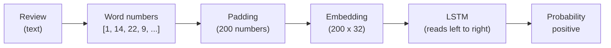
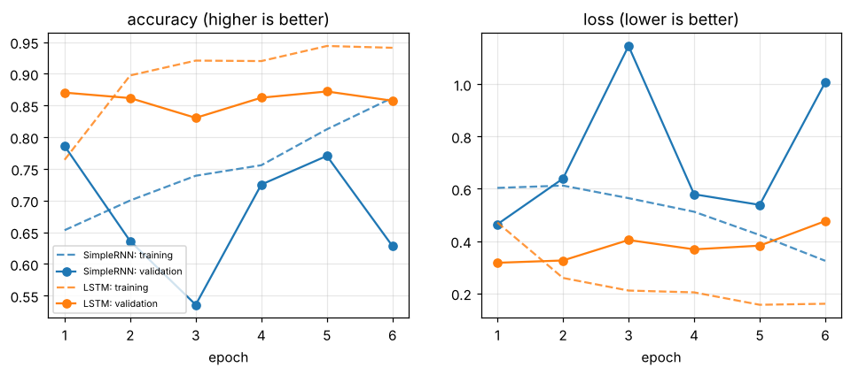
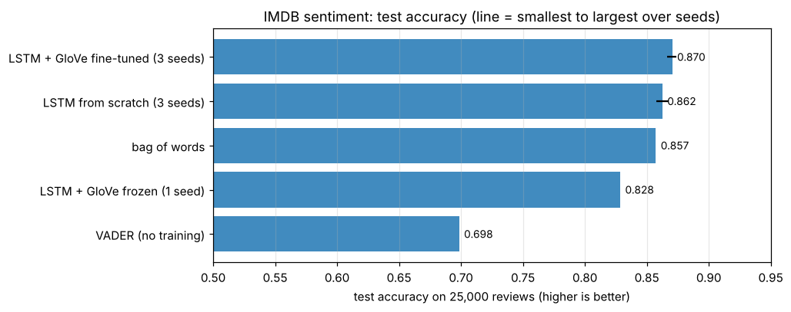
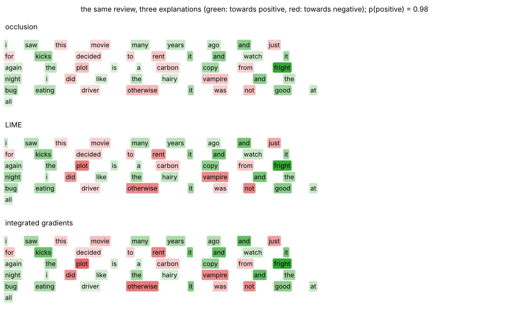

# Sentiment of movie reviews: from words to numbers to an LSTM

> **After this tutorial you will be able to** explain how a computer turns a movie review into numbers, what an embedding
> and an LSTM are, train a first model on the IMDB reviews, and judge honestly whether it beats a much simpler method.

[](https://colab.research.google.com/github/maryammahmoudi1993/LSTM_emotion_recognition/blob/main/notebooks/01_text_to_numbers_embeddings_lstm.ipynb)

> **Status:** all three notebooks are ready.

## Who this is for

- **For:** learners who know basic Python and NumPy and have never trained a neural network on text.
- **Not needed:** a GPU, a maths degree, or your own data. Everything runs on a laptop CPU.
- **Time:** about 35 minutes for notebook 01 (about four minutes of training) about 40 minutes for notebook 02 (about twelve minutes of training) and about 40 minutes for notebook 03 (about four minutes of computing).

## What you will learn

- How a review becomes a list of word numbers, and why padding is needed.
- What an embedding is (a learned lookup table of coordinates) and what it learned here.
- How an LSTM reads a sentence with a gated memory, and why a plain `SimpleRNN` is unstable.
- Why every neural result needs a simple baseline next to it (here: counting words). (01)
- What "pretrained" means, how to start an LSTM from pretrained GloVe word vectors, and how to compare models fairly with several seeds and one shared test set. (02)
- How to explain a prediction word by word with occlusion, LIME and integrated gradients, how to test whether an explanation is faithful, and what explanations cannot tell you. (03)

## The pipeline in one picture



<p align="center">
  <br>
  <em>The SimpleRNN (blue) is unstable; the LSTM (orange) is good from the first epoch but starts to memorise the training reviews.</em>
</p>

## How to run

**In the browser (no installation):** click the Colab badge above. Colab already has TensorFlow and scikit-learn;
the first cell downloads this repository for you.

**On your computer** (Python 3.13 was tested; any recent Python 3 that TensorFlow supports should work):

```bash
git clone https://github.com/maryammahmoudi1993/LSTM_emotion_recognition.git
cd LSTM_emotion_recognition
python -m venv .venv
source .venv/bin/activate
pip install -r requirements.txt
python -m ipykernel install --user --name python3
jupyter lab notebooks/
```

If `jupyter` is not found, run `pip install jupyterlab` first (it is not needed to run the tests).

Check that everything works (runs the smoke tests and every notebook, about twenty minutes):

```bash
python -m pytest -q
```

The data (IMDB reviews as provided by Keras, about 20 MB) is downloaded automatically on the first run; see [`data/README.md`](data/README.md).

## Contents

| # | Notebook | You will learn | Status |
|---|---|---|---|
| 01 | [From words to numbers: embeddings and a first LSTM](notebooks/01_text_to_numbers_embeddings_lstm.ipynb) | text to numbers, embeddings, LSTM, a simple baseline, honest evaluation | ready |
| 02 | [Pretrained word vectors and an honest comparison](notebooks/02_pretrained_vectors_and_baselines.ipynb) | transfer learning with GloVe, frozen versus fine-tuned, three seeds, bag of words and VADER as reference points | ready |
| 03 | [Why this verdict? Word-level explanations](notebooks/03_word_level_explanations.ipynb) | occlusion, LIME and integrated gradients, a deletion test of faithfulness, stability of LIME, and the limits of explanations | ready |

Other folders: [`src/`](src) shared code, [`tests/`](tests) smoke tests and a test that runs every notebook,
[`legacy/`](legacy) the original 2023 files (untouched), [`assets/`](assets) figures and [credits](assets/CREDITS.md).

## Results so far

### Notebook 01

All numbers come from running notebook 01 (fixed seed 42, CPU, 20,000 training and 5,000 validation reviews, at most 6 epochs,
the weights of the epoch with the best validation accuracy are kept, evaluation on the official 25,000 test reviews, one run each).

| Model | Test accuracy |
|---|---|
| Bag of words + logistic regression (counts words, ignores order) | 0.8572 |
| SimpleRNN (the layer of the first version) | 0.7966 |
| LSTM | 0.8626 |

The LSTM and the word-counting baseline are about half a percentage point apart: from one run we cannot say that the LSTM is better.

### Notebook 02: pretrained word vectors (same data, 25,000 test reviews, seeds 42, 1, 2)

| Model | Test accuracy |
|---|---|
| LSTM + GloVe fine-tuned (3 seeds) | 0.8704 mean (0.8661 to 0.8738) |
| LSTM from scratch (3 seeds) | 0.8625 mean (0.8574 to 0.8675) |
| Bag of words + logistic regression | 0.8572 |
| LSTM + GloVe frozen (1 seed, 6 epochs) | 0.8285 |
| VADER, a ready-made rule-based tool, no training (on rebuilt text without punctuation) | 0.6984 |

Fine-tuned GloVe was ahead of the from-scratch LSTM for every seed (by 0.35, 0.63 and 1.40 points), a small and consistent gain; the word-counting baseline is only about one point behind the best LSTM.
**Not tested:** a pretrained Transformer. The host that serves such models (huggingface.co) refused the connection from the environment in which this was written, so no result for one is claimed.

<p align="center">
  <br>
  <em>Test accuracy of the compared models (bars start at 0.5, the coin-flip level; thin lines span the seeds).</em>
</p>

### Notebook 03: word-level explanations (the LSTM of notebook 01, 40 short test reviews)

| Words deleted | Average drop of the model's confidence in its verdict |
|---|---|
| the 3 words picked by occlusion | 0.302 |
| the 3 words picked by integrated gradients | 0.301 |
| the 3 words picked by LIME | 0.291 |
| the 3 words with the largest weights of the linear model | 0.241 |
| 3 random words | 0.015 |

The three explanation methods agree on about two of their three most important words and, in this test, describe the model faithfully; LIME was stable across two seeds (2.8 of 3 shared words on 10 reviews).
They also revealed a failure: the first review (negative) is classified "positive" with 98% because the model leans on plot words and does not read "not good at all" as a negation.
Explanations describe the model, not the world, and depend on the method (see the notebook for the limits).

<p align="center">
  <br>
  <em>One review, three explanations (green: towards positive, red: towards negative).</em>
</p>

## Learning journey

| | **Then (2023, in [`legacy/`](legacy))** | **Now** |
|---|---|---|
| Model | one `SimpleRNN` layer (called "LSTM" in the title and the README) | a real LSTM, next to a `SimpleRNN` and a word-counting baseline |
| Input | 20,000-word vocabulary, 80 words per review, 128 coordinates per word | 10,000-word vocabulary, 200 words per review, 32 coordinates per word (small on purpose) |
| Evaluation | the test reviews were used as validation data in every epoch; no seed | separate training, validation and test sets; seed 42; test set opened once |
| Results | final test accuracy 0.7492 in the saved output, unstable between epochs (0.64 to 0.81) | table above, curves, and a discussion of what the numbers do and do not show |
| Explanation | the README describes the code | notebooks explain every step with pictures and small experiments |

What I would do differently: start with a simple baseline, keep the test set locked, fix the seed, and write down what each step teaches.
See [`legacy/ABOUT.md`](legacy/ABOUT.md) for what I notice in the original notebook today.

## Limitations

- Small models, few epochs and one seed: the numbers show a trend, not the best possible accuracy.
- Word-level explanations were tested on 40 short reviews, one model and one seed.
- Reviews are cut to 200 words and rare words are replaced by "unknown".
- The IMDB data set is English movie reviews; the models say nothing about other kinds of text.
- The GloVe vectors are downloaded from the gensim-data distribution; the licence listed there is the Public Domain Dedication and License (PDDL). I could not open the original Stanford page to double-check it.
- **Licence of the data:** I could not check the terms of use of the data set from the environment where this was written; the data is loaded through Keras and is not part of this repository (see [`data/README.md`](data/README.md)).

## Further reading

- Maas, Daly, Pham, Huang, Ng and Potts (2011), *Learning Word Vectors for Sentiment Analysis*, ACL 2011, <https://aclanthology.org/P11-1015/> (the data set).
- Pennington, Socher and Manning (2014), *GloVe: Global Vectors for Word Representation*, EMNLP 2014, <https://aclanthology.org/D14-1162/> (the pretrained vectors).
- Hutto and Gilbert (2014), *VADER: A Parsimonious Rule-based Model for Sentiment Analysis of Social Media Text*, ICWSM 2014 (the ready-made tool).
- Ribeiro, Singh and Guestrin (2016), *"Why Should I Trust You?": Explaining the Predictions of Any Classifier*, KDD 2016 (LIME, <https://arxiv.org/abs/1602.04938>).
- Sundararajan, Taly and Yan (2017), *Axiomatic Attribution for Deep Networks*, ICML 2017 (integrated gradients, <https://arxiv.org/abs/1703.01365>).
- Hochreiter and Schmidhuber (1997), *Long Short-Term Memory*, Neural Computation 9(8), 1735-1780 (the LSTM).
- Keras documentation: [Embedding layer](https://keras.io/api/layers/core_layers/embedding/) and [LSTM layer](https://keras.io/api/layers/recurrent_layers/lstm/).

## License

MIT, see [`LICENSE`](LICENSE). The IMDB data set is not covered by this licence.
